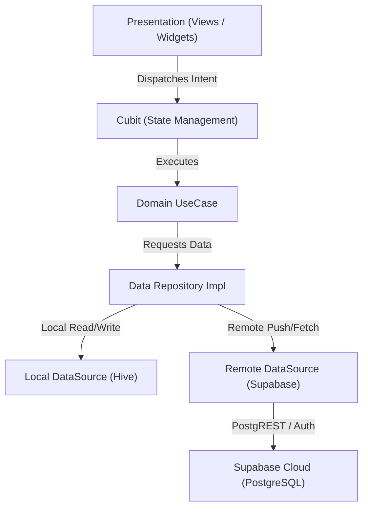
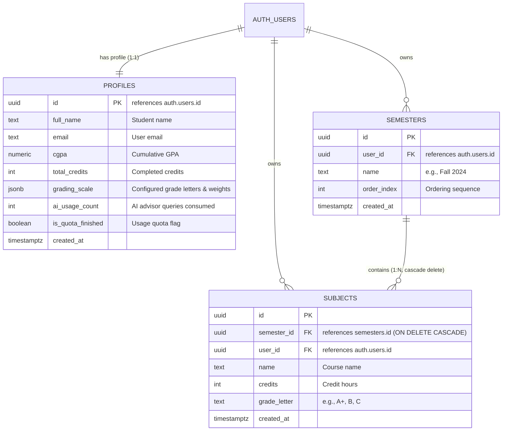
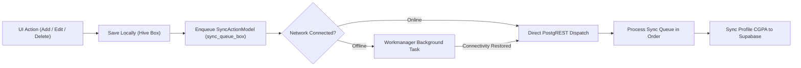

# AcademIQ (GPA Calculator)

[](https://flutter.dev/)
[](https://dart.dev/)
[](https://supabase.com/)
[](https://pub.dev/packages/hive)
[](https://bloclibrary.dev/)

**AcademIQ** is a modern, offline-first Flutter application designed to help university students track their academic progress, calculate Semester and Cumulative GPA (CGPA) in real-time, and receive personalized AI-driven academic advice.

---

## 🎥 Demo

<video src="https://res.cloudinary.com/rj3iz5na/video/upload/v1/AcademIQ.mp4" width="300" controls></video>

*(If the player above does not load, [click the image below to watch the video](https://res.cloudinary.com/rj3iz5na/video/upload/v1/AcademIQ.mp4))*

[](https://res.cloudinary.com/rj3iz5na/video/upload/v1/AcademIQ.mp4)

## 🚀 Try the App
Want to see AcademIQ in action? You can download the fully built, production-ready application directly from the **[Releases](../../releases)** page. Simply download the latest `.apk` file to your Android device, install it, and experience the smooth, offline-first performance and premium dark UI instantly.

---

## 📋 Project Documentation & Planning

AcademIQ follows strict software engineering discipline throughout its lifecycle:

### 🏢 Business Requirements Document (BRD)
University students often struggle with tracking complex grading curves, semester weighting, and cumulative GPA progression across academic terms. AcademIQ establishes its Unique Value Proposition (UVP) by merging:
- **Instant Local Calculations:** Zero-latency feedback on mobile devices.
- **Offline-First Resilience:** Continuous functionality without requiring constant internet access.
- **Contextual AI Advising:** Practical study strategies and credit load guidance tailored to the student's actual transcript.

### 📝 Product Requirements Document (PRD)
* **Storage & Synchronization:** Dual-tier data model utilizing Hive for instant local reads/writes and Supabase PostgreSQL for cloud persistence and multi-device sync.
* **UI/UX Guidelines:** Glassmorphism with deep space backgrounds (`#0B0814`), Rose/Indigo gradients, Skeletonizer shimmer loaders, and non-blocking dialogs.
* **Error Resilience:** Complete isolation of failure states via typed `ApiResult<T>` unions, preventing crash loops.
* **Quota Management:** Strict tracking of AI Advisor token consumption per user account.

### 📅 Strategic Planning (Phases & Sprints)
* **Phase 1: Foundation & Architecture:** Feature-first Clean Architecture, Service Locator (`get_it`), and sealed `ApiResult<T>` result wrapper.
* **Phase 2: Local & Cloud Persistence:** Hive TypeAdapters, Supabase PostgreSQL schema, RLS policies, and database triggers.
* **Phase 3: Logic & External Integrations:** Cubits, deterministic GPA calculator utility, Supabase Auth, and OpenRouter AI API.
* **Phase 4: Background Sync & UI Polish:** Workmanager background sync queue, customizable grading scale settings, and interactive UI feedback.

---

## ✨ Features

* ⚡ **Offline-First Architecture**: Seamlessly read and write academic data without an internet connection. Changes queue up locally in Hive and automatically synchronize with Supabase in the background via Workmanager.
* 🧮 **Smart GPA & CGPA Calculation**: Add custom semesters and subjects to instantly recalculate semester GPA and cumulative CGPA.
* ⚙️ **Customizable Grading Scale**: Fine-tune letter grades, grade points (e.g., A = 4.0, A- = 3.67), and minimum score thresholds directly in Settings.
* 🤖 **AI Academic Advisor**: Integrates with OpenRouter LLMs to provide actionable advice, SWOT analyses of grades, and course planning suggestions.
* 🔐 **Secure Cloud Authentication**: Powered by Supabase Auth with automatic session persistence and token refresh.
* 🎨 **Modern Dark UI**: Premium typography, subtle glassmorphism cards, and smooth navigation animations.

---

## 🛠 Tech Stack

* **Framework:** [Flutter](https://flutter.dev/) (Dart 3 with pattern matching and sealed classes)
* **Backend as a Service:** [Supabase](https://supabase.com/) (PostgreSQL, Auth, Row-Level Security, PostgREST)
* **Local Storage:** [Hive](https://pub.dev/packages/hive) & [hive_flutter](https://pub.dev/packages/hive_flutter)
* **Background Scheduling:** [workmanager](https://pub.dev/packages/workmanager)
* **State Management:** [flutter_bloc](https://pub.dev/packages/flutter_bloc) (Cubit pattern)
* **Dependency Injection:** [get_it](https://pub.dev/packages/get_it)
* **AI Analysis:** [OpenRouter API](https://openrouter.ai/)
* **Typography & UI Polish:** `google_fonts`, `skeletonizer`, `flutter_markdown`

---

## 🏗 Architecture

The project strictly follows **Clean Architecture** organized with a **Feature-First** structure:

```
lib/
├── config/             # Themes (AppColors, AppTextStyles), AppRoutes (onGenerateRoute)
├── core/               # Shared cross-cutting components
│   ├── background_sync/# Workmanager callbackDispatcher & background tasks
│   ├── constants/      # AppConstants, borders, icons
│   ├── errors/         # Failures and Exceptions hierarchy
│   ├── networking/     # ApiResult sealed class, SupabaseInterceptor, ApiErrorHandler
│   ├── utls/           # GetIt service locator setup
│   └── widgets/        # Reusable global widgets (buttons, error displays, dialogs)
└── features/           # Feature-sliced modules
    ├── ai_advisor/     # AI analysis prompts, repository, and UI
    ├── auth/           # Login, registration, and Supabase auth logic
    ├── home/           # Semesters, subjects, GPA calculation, and sync pipeline
    ├── main_layout/    # Bottom navigation bar and persistent scaffolding
    ├── onboarding/     # First-launch walkthrough
    ├── settings/       # Profile management and grading scale customization
    └── splash/         # App initialization and auth dispatch
```

### Architecture Flow



### Error Handling Pattern (`ApiResult<T>`)
Rather than throwing uncaught exceptions or relying on heavy code generation, AcademIQ leverages native Dart 3 `sealed class` unions:

```dart
sealed class ApiResult<T> {
  const ApiResult();
  R when<R>({
    required R Function(T data) success,
    required R Function(Failure failure) failure,
  }) {
    return switch (this) {
      Success<T>(:final data) => success(data),
      FailureResult<T>(:final failure) => failure(failure),
    };
  }
}
```
Repositories capture raw network or database exceptions and wrap them into typed `ApiResult.success()` or `ApiResult.failure()`. Cubits consume results exhaustively using `.when()`.

---

## 🗄️ Backend & Database Architecture (Supabase)

Supabase serves as the managed cloud relational backend for AcademIQ, handling identity authentication, transactional records, and real-time syncing.

### 📊 Database Schema & Entity Relationships



### 📋 Table Specifications

1. **`public.profiles`**: Holds personal student data, aggregated academic performance (`cgpa`, `total_credits`), customized grading scale configurations (`grading_scale` stored as JSONB), and AI request quota tracking.
2. **`public.semesters`**: Contains semester collections with an `order_index` to preserve Chronological term ordering.
3. **`public.subjects`**: Stores individual courses, credit hours, and grade letters. Foreign keys link each subject to both its parent `semester_id` and the owning `user_id`. Cascading deletes ensure that purging a semester cleanly deletes all its child subjects.

---

### ⚡ PostgreSQL Functions & Triggers

To prevent client-side race conditions and keep authentication lean, student profiles are initialized directly on the database level via a PL/pgSQL trigger.

#### Automatic Profile Creation (`handle_new_user`)
When a student signs up via `auth.signUp()`, this function executes `AFTER INSERT ON auth.users`, populating `public.profiles` with the student's name from user metadata and seeding the standard 4.0 grading scale:

```sql
-- 1. Create the profile initialization function
create or replace function public.handle_new_user()
returns trigger as $$
begin
  insert into public.profiles (
    id,
    full_name,
    email,
    cgpa,
    total_credits,
    ai_usage_count,
    is_quota_finished,
    grading_scale
  )
  values (
    new.id,
    coalesce(new.raw_user_meta_data->>'full_name', 'Student'),
    new.email,
    0.0,
    0,
    0,
    false,
    '[
      {"letter": "A+", "gpa": 4.0, "minScore": 90, "enable": true},
      {"letter": "A", "gpa": 3.67, "minScore": 85, "enable": true},
      {"letter": "A-", "gpa": 3.33, "minScore": 80, "enable": true},
      {"letter": "B+", "gpa": 3.0, "minScore": 75, "enable": true},
      {"letter": "B", "gpa": 2.67, "minScore": 70, "enable": true},
      {"letter": "B-", "gpa": 2.33, "minScore": 65, "enable": true},
      {"letter": "C+", "gpa": 2.0, "minScore": 60, "enable": true},
      {"letter": "C", "gpa": 1.67, "minScore": 55, "enable": true},
      {"letter": "C-", "gpa": 1.33, "minScore": 50, "enable": true},
      {"letter": "D", "gpa": 1.0, "minScore": 40, "enable": true},
      {"letter": "F", "gpa": 0.0, "minScore": 0, "enable": true}
    ]'::jsonb
  );
  return new;
end;
$$ language plpgsql security definer;

-- 2. Bind the trigger to Supabase auth.users
create trigger on_auth_user_created
  after insert on auth.users
  for each row execute procedure public.handle_new_user();
```

---

### 🛡️ Row-Level Security (RLS) Policies

All tables enforce PostgreSQL Row-Level Security to maintain strict multi-tenant data isolation:

```sql
-- Enable RLS on all tables
alter table public.profiles enable row level security;
alter table public.semesters enable row level security;
alter table public.subjects enable row level security;

-- Profiles: Users can only view and update their own profile
create policy "Users can view own profile"
  on public.profiles for select
  using (auth.uid() = id);

create policy "Users can update own profile"
  on public.profiles for update
  using (auth.uid() = id);

-- Semesters: Users can perform all operations only on their own records
create policy "Users can manage own semesters"
  on public.semesters for all
  using (auth.uid() = user_id)
  with check (auth.uid() = user_id);

-- Subjects: Users can perform all operations only on their own subjects
create policy "Users can manage own subjects"
  on public.subjects for all
  using (auth.uid() = user_id)
  with check (auth.uid() = user_id);
```

---

### 🔄 Offline-First Synchronization & Queue Pipeline

AcademIQ's synchronization architecture guarantees zero data loss and an immediate, responsive UI:



1. **Optimistic Local Mutations:** All CRUD operations immediately persist to local Hive boxes (`semesters_box`, `subjects_box`, `settings_box`).
2. **Persistent Sync Queue:** Each mutation generates a `SyncActionModel` containing the action type (`addSemester`, `updateSubject`, `deleteSemester`, etc.) and JSON payload, stored in `sync_queue_box`.
3. **Background Worker Execution:** `Workmanager().registerOneOffTask()` schedules execution with network constraints (`NetworkType.connected`). The headless `callbackDispatcher` processes pending actions in chronological order against Supabase.
4. **Calculated Metric Synchronization:** Whenever local courses change, local CGPA and credit totals are recalculated and updated in `profiles.cgpa` and `profiles.total_credits`.

---

### 🔍 Network Observability & Error Handling

* **`SupabaseInterceptor`:** A custom `http.BaseClient` middleware that logs incoming and outgoing Supabase HTTP calls with timestamps, methods, status codes, and URLs during `kDebugMode`.
* **`ApiErrorHandler`:** Translates low-level errors into human-readable messages:
  * **Auth Errors:** Invalid credentials, duplicate accounts, weak passwords, and network timeouts.
  * **PostgreSQL Codes:** Maps `42501` (Row-Level Security violation), `23505` (unique constraint violation), and `53300` (connection limit reached) to friendly domain failures.

---

## ⚙️ Environment Configuration & Getting Started

### 1. Prerequisites
* [Flutter SDK](https://docs.flutter.dev/get-started/install) (>= 3.x)
* [Dart SDK](https://dart.dev/get-dart) (>= 3.x)
* A [Supabase](https://supabase.com/) project with Auth and Database enabled
* An [OpenRouter API Key](https://openrouter.ai/) for AI Advisor capabilities

### 2. Configure Environment Variables
Create a `.env` file in the root directory:

```env
SUPABASE_URL=https://your-project-id.supabase.co
SUPABASE_ANON_KEY=your-supabase-anon-key
OPENROUTER_API_KEY=your-openrouter-api-key
```

### 3. Initialize Database Tables
Execute the SQL statements from the **Database Architecture** section above in your Supabase project's **SQL Editor** to create the tables, trigger function, and RLS policies.

### 4. Install Dependencies & Run
```bash
# Fetch Flutter packages
flutter pub get

# Run on connected device or emulator
flutter run
```

---

## 📄 License
This project is licensed under the MIT License.
